# Lab Sheet 5 — Express.js

**Course:** Full Stack Web Development (BTCS303P)
**Department:** Computer Science & Engineering, COER University, Roorkee

This repository contains my solutions for **Lab Sheet 5**, a practical introduction to Express.js: project setup, routing, route parameters and query strings, middleware, JSON and form handling, modular routers, a REST API with CRUD, error handling, static files, environment config, and a final mini project (Library Management API).

All the code lives directly in this folder. Output screenshots for every part are in the `screenshots` folder and shown below.

---

## Prerequisites

- [Node.js](https://nodejs.org/) v18 or later (check with `node -v`)
- npm (comes with Node.js)
- Postman, Thunder Client, or PowerShell's `Invoke-RestMethod` for testing the API

## Getting Started

```bash
git clone https://github.com/Atul200429/Full-Stack-Lab-2026-27-ODD-Sem-3rd-Year-Section-B.git
cd Full-Stack-Lab-2026-27-ODD-Sem-3rd-Year-Section-B/LAB-SHEET-5
npm install
```

Create a `.env` file in this folder (it is git-ignored, so it is not in the repo):

```
PORT=4000
```

Start the server:

```bash
# normal run
node index.js

# auto-restart on file changes (nodemon)
npm run dev
```

The server runs at `http://localhost:4000`.

---

## Project Structure

```
LAB-SHEET-5/
├── public/
│   ├── index.html
│   └── style.css
├── routes/
│   ├── books.js
│   ├── members.js
│   ├── students.js
│   └── tasks.js
├── screenshots/            (output screenshots used in this README)
├── .env                    (not committed)
├── .gitignore
├── index.js
├── package.json
├── package-lock.json
└── README.md
```

---

## What Each Part Covers

| Part | Topic | Concepts Used |
|------|-------|---------------|
| A | Project Setup | `npm init`, `express`, `nodemon`, `dev` script |
| B | Basic Routing | `GET` and `POST` routes, JSON responses, echo endpoint |
| C | Route Parameters & Query Strings | `req.params`, `req.query` |
| D | Middleware | Custom logger, `x-api-key` check on `/admin` |
| E | JSON & Forms | `express.json()`, `express.urlencoded()` |
| F | Modular Routes | `express.Router()`, mounting under `/api/...` |
| G | REST API (CRUD) | In-memory `tasks` array, GET / POST / PUT / DELETE |
| H | Error Handling | 404 handler, centralized error middleware, `next(err)` |
| I | Static Files & Environment Config | `express.static()`, `dotenv` |
| J | Mini Project | Library Management API: books and members CRUD |

> Parts A–I were built step by step in `index.js`. The final `index.js` is the Part J version, which mounts only the books and members routers. `students.js` and `tasks.js` stay in `routes/` as the Part F/G work.

---

## API Reference (Final Version — Library Management API)

All `/api` routes require the header `x-api-key: library123`. Without it the server returns `401 Unauthorized`.

| Method | Endpoint | Description |
|--------|----------|-------------|
| GET | `/api/books` | List all books |
| GET | `/api/books/:id` | Get one book (404 if not found) |
| POST | `/api/books` | Add a book (`title`, `author`) |
| PUT | `/api/books/:id` | Update a book |
| DELETE | `/api/books/:id` | Delete a book |
| GET | `/api/members` | List all members |
| GET | `/api/members/:id` | Get one member (404 if not found) |
| POST | `/api/members` | Add a member (`name`, `email`) |
| PUT | `/api/members/:id` | Update a member |
| DELETE | `/api/members/:id` | Delete a member |

**Middleware:** a request logger (method, URL, timestamp) on every request, and a fake auth check on all `/api` routes.
**Error handling:** unmatched URLs return `{ "error": "Route not found" }`; a centralized handler logs the error and returns JSON with the right status code.

Example (PowerShell):

```powershell
Invoke-RestMethod -Uri "http://localhost:4000/api/books" -Method GET -Headers @{"x-api-key"="library123"} | ConvertTo-Json -Depth 5
```

Example (curl):

```bash
curl http://localhost:4000/api/books -H "x-api-key: library123"
```

### Routes from earlier parts

| Method | Endpoint | Part | Description |
|--------|----------|------|-------------|
| GET | `/` | A | "Express Lab Running" |
| GET | `/about` | B | Name and roll number as JSON |
| GET | `/courses` | B | Array of 3 course names |
| POST | `/echo` | B | Returns the JSON body that was sent |
| GET | `/students/:id` | C | `{ id, message: "Student details" }` |
| GET | `/search?name=&age=` | C | Echoes the query parameters |
| GET | `/products/:category/:id` | C | Returns category and id from the URL |
| GET | `/admin/dashboard` | D | Needs `x-api-key` header, otherwise `403 Forbidden` |
| POST | `/register` | E | Success message with the submitted name |
| POST | `/contact` | E | Urlencoded form, logged to console, thank-you reply |
| GET | `/api/students/:id` | F | Same as above, through `express.Router()` |
| GET / POST | `/api/books`, `/api/books/:id` | F | Books router (3 routes) |
| GET / POST / PUT / DELETE | `/api/tasks`, `/api/tasks/:id` | G | Tasks CRUD (in-memory) |
| GET | `/test-error` | H | Triggers the centralized error handler |

---

## Screenshots

### Part A — Project Setup

| nodemon dev server | GET / |
|---|---|
| 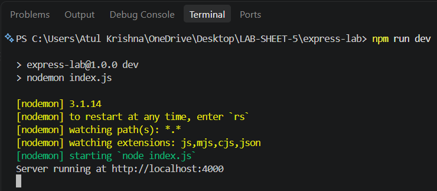 | 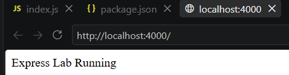 |

### Part B — Basic Routing

**GET /about**
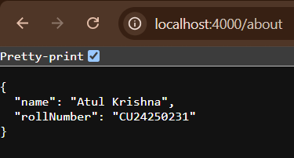

**GET /courses**
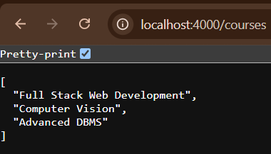

**POST /echo**
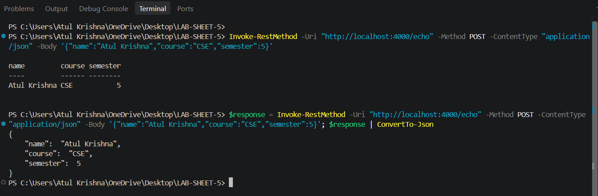

### Part C — Route Parameters & Query Strings

**GET /students/101**
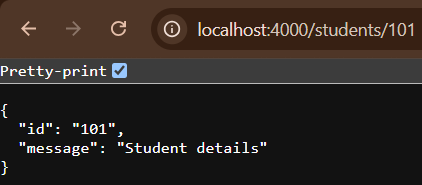

**GET /search?name=Atul&age=21**
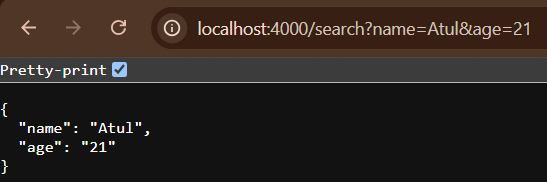

**GET /products/laptop/101**
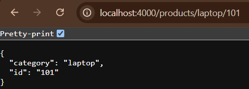

### Part D — Middleware

**Logger output**
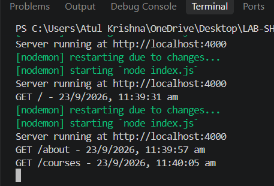

**/admin/dashboard without the header (403)**
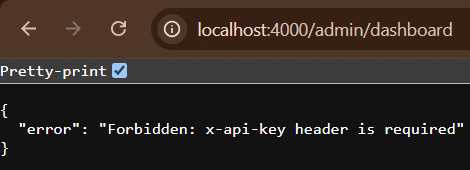

**/admin/dashboard with the header**
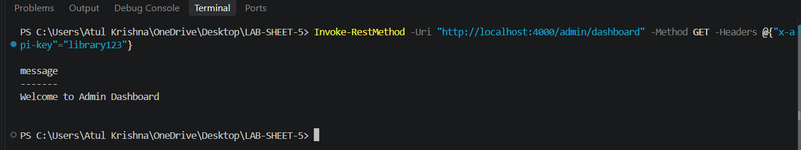

### Part E — JSON & Forms

**POST /register**
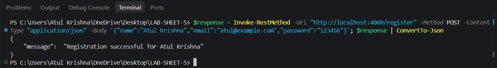

**POST /contact (urlencoded form)**
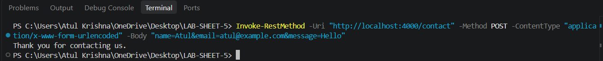

**Form data logged in the server console**
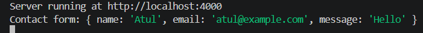

### Part F — express.Router()

**GET /api/students/101**
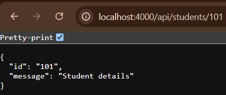

**GET /api/books**
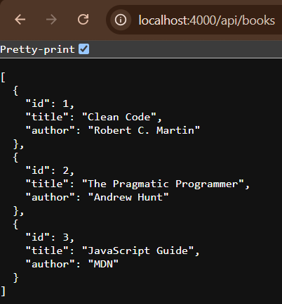

**GET /api/books/1**
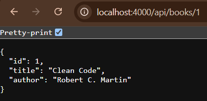

**POST /api/books**
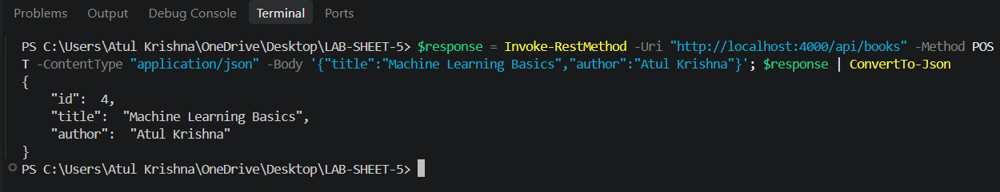

### Part G — REST API (CRUD on tasks)

**GET /api/tasks**
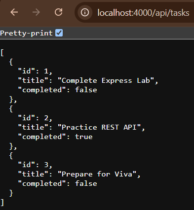

**GET /api/tasks/1**
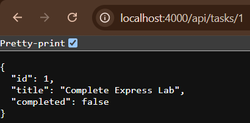

**POST, PUT and DELETE**
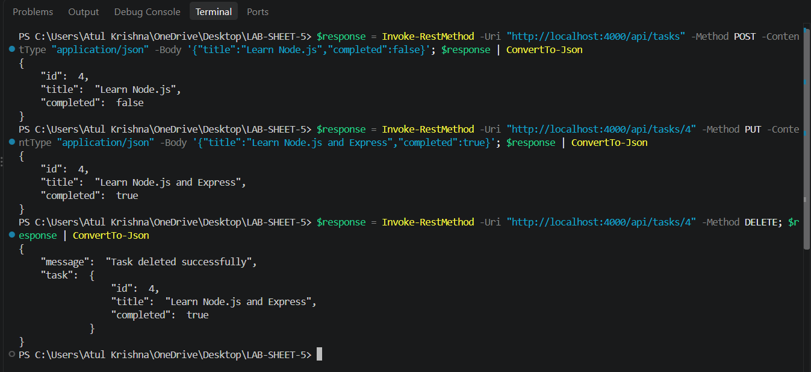

### Part H — Error Handling

**404 for an unknown route**
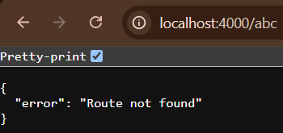

**404 for an unknown /api route**
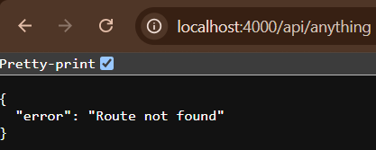

**Centralized error handler (/test-error)**
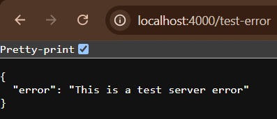

**`next(err)` with a 404 for a missing task**
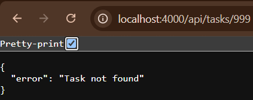

### Part I — Static Files & Environment Config

**Static page served from `public/`**
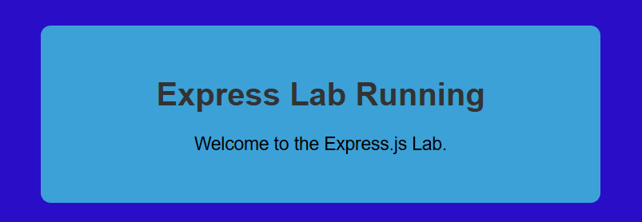

**Port read from `.env` via dotenv**
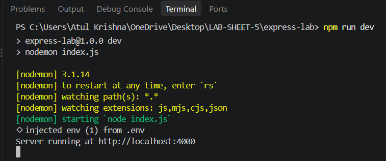

### Part J — Library Management Mini API

**Request without the API key (401)**
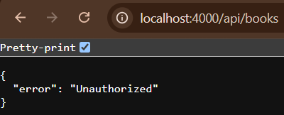

**Books**

| Endpoint | Screenshot |
|----------|------------|
| GET /api/books | 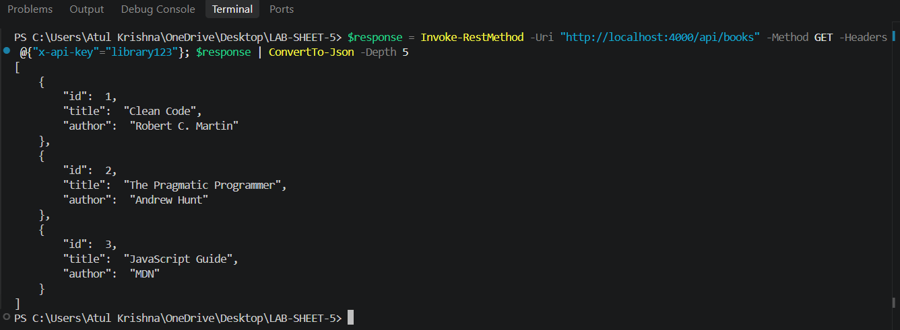 |
| GET /api/books/1 | 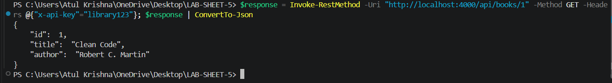 |
| POST /api/books | 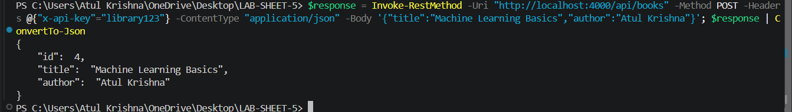 |
| PUT /api/books/4 | 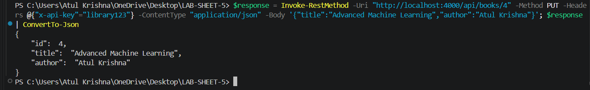 |
| DELETE /api/books/4 | 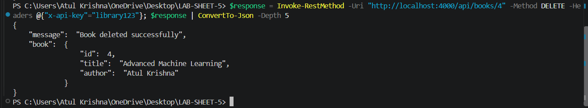 |

**Members**

| Endpoint | Screenshot |
|----------|------------|
| GET /api/members | 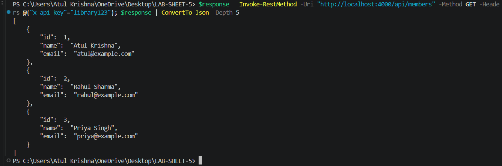 |
| GET /api/members/1 | 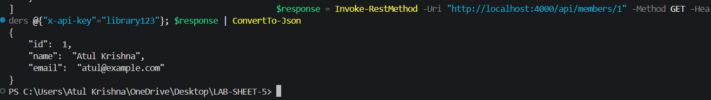 |
| POST /api/members | 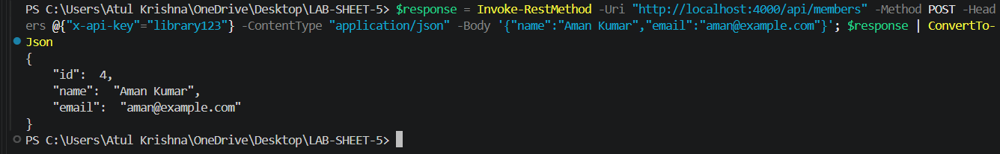 |
| PUT /api/members/4 | 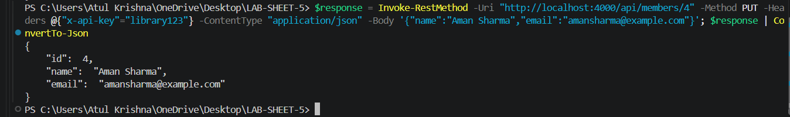 |
| DELETE /api/members/4 | 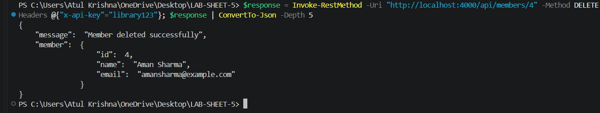 |

**Error responses**

| Case | Screenshot |
|------|------------|
| GET /api/books/999 (404) | 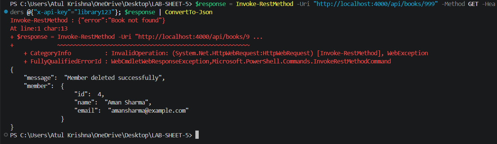 |
| GET /api/members/999 (404) | 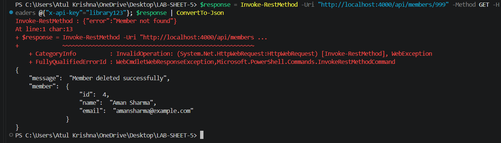 |
| GET /api/anything (404) | 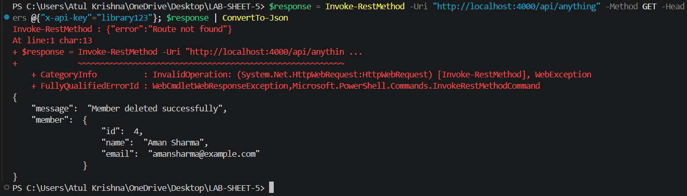 |

**Server console with request logger and error logs**
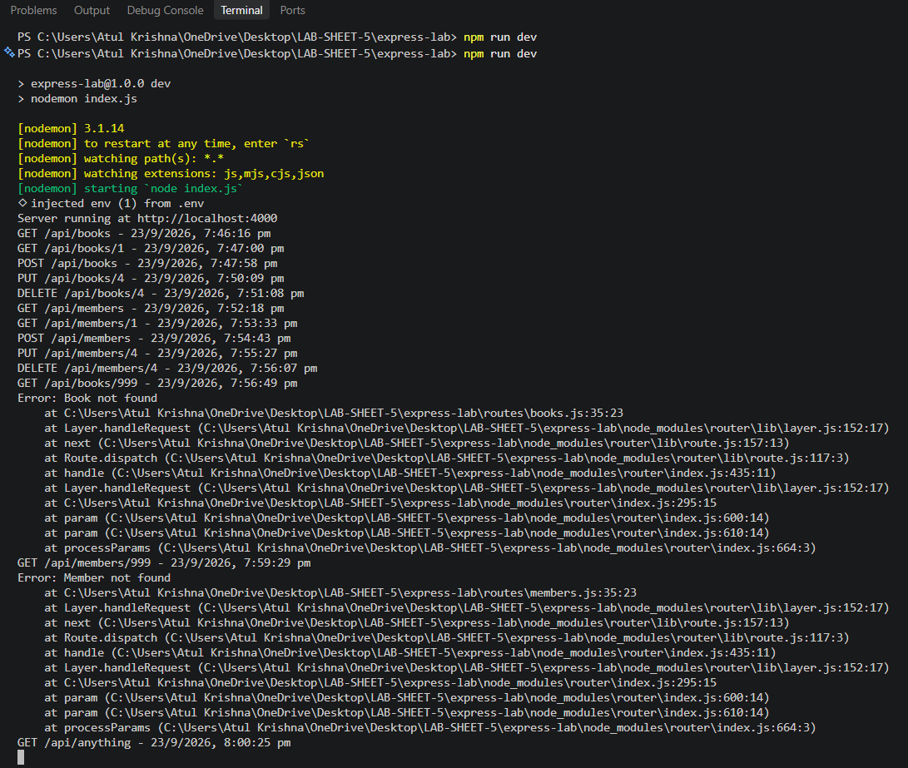

---

## Concepts Covered

- Express app setup and nodemon workflow
- Routing, route parameters, and query strings
- Application-level and route-specific middleware
- Parsing JSON and urlencoded form bodies
- Modular code with `express.Router()`
- Designing a REST API with full CRUD
- 404 handling and centralized error handling
- Serving static files
- Environment variables with `dotenv`

---

## Author

**Atul Krishna**
B.Tech Computer Science & Engineering, COER University, Roorkee
GitHub: [@Atul200429](https://github.com/Atul200429)

---

*Submitted as part of the Full Stack Web Development lab coursework.*
